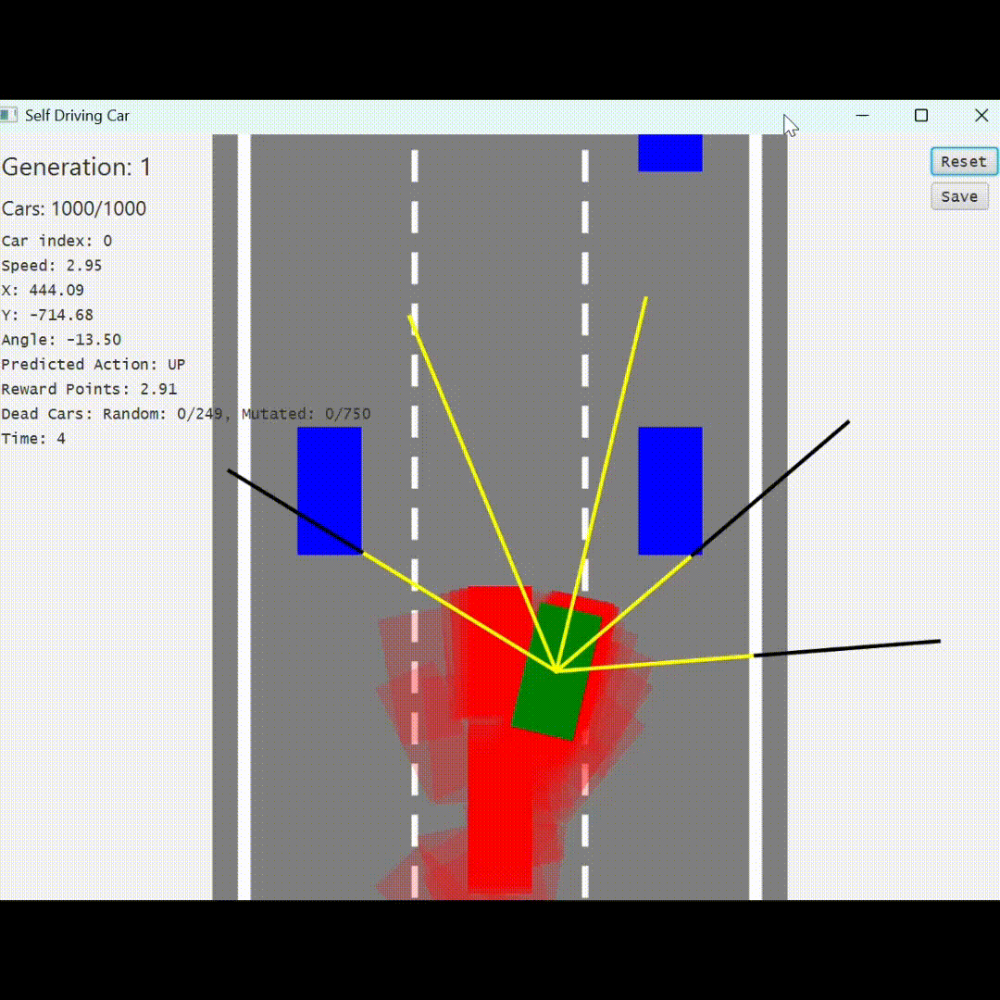

# 🚗 Self-Driving Car AI — Java

A 2D self-driving car simulation built with **Java and JavaFX**, featuring a custom Neural Network and Genetic Algorithm.

The goal is simple: teach an AI-controlled car to navigate an infinite three-lane highway, avoid incoming traffic, and survive for as long as possible — without manually controlling it.

This project was built as a hands-on experiment to understand Neural Networks, Genetic Algorithms, and evolutionary learning by implementing the concepts from scratch.

## 🎮 Project Preview

<!-- Add your gameplay GIF or screenshot here -->

## ✨ Features

- **Three-Lane Highway:** An infinite scrolling road with incoming traffic.
- **Autonomous Driving:** The car makes its own driving decisions using a Neural Network.
- **Traffic Detection:** Sensors provide information about nearby traffic.
- **Custom Neural Network:** A feed-forward neural network implemented from scratch.
- **Genetic Algorithm:** Evolves neural network weights and biases across generations.
- **Fitness-Based Selection:** Evaluates driving performance to identify better-performing brains.
- **Brain Persistence:** Supports saving and loading trained neural network parameters.

## 🧠 How It Works

The project uses a combination of Neural Networks and Genetic Algorithms to create an autonomous driving agent.

### 1. Sensors and Perception

The AI car uses sensors to detect nearby traffic. The sensor readings are passed to the Neural Network as inputs.

### 2. Neural Network

A custom feed-forward Neural Network processes the sensor information and determines the car's driving actions.

The network uses:
- Neurons
- Weights and biases
- Layers
- Activation functions

No external machine learning framework is required for the neural network implementation.

### 3. Genetic Algorithm

Instead of training through traditional backpropagation, the network improves through evolutionary training.

The learning process:

1. Generate a population of AI-controlled cars with different neural networks.
2. Let each car navigate the highway.
3. Evaluate each car using a fitness function.
4. Select better-performing brains.
5. Mutate their weights and biases to create a new generation.
6. Repeat the process.

Over multiple generations, the population can evolve better traffic-avoidance behavior.

## ⚙️ Technology Stack

- **Language:** Java
- **GUI and Rendering:** JavaFX
- **AI:** Custom Neural Network
- **Training:** Genetic Algorithm
- **Model Persistence:** Java Serialization

## 🧬 Training the AI

The AI is not guaranteed to drive intelligently immediately.

It needs to evolve through multiple generations. Let the simulation run, observe the cars' behavior, and allow the Genetic Algorithm to select and mutate better-performing brains.

The quality of the trained AI depends on factors such as:

- Traffic arrangements encountered during training.
- Sensor information available to the network.
- Fitness function design.
- Genetic Algorithm parameters.
- Number of training generations.

### Important: Generalization

A trained brain may perform well in the traffic scenarios it encountered during training but struggle with unfamiliar arrangements.

For example, a brain that learned to overtake using the left lane may not immediately adapt when the left lane is blocked and only the right lane is available.

This is an experimental learning project, not a fully generalized autonomous driving system. Different traffic configurations may require additional training and improvements to the learning process.

## 🎯 Learning Objectives

This project helped me explore:

- Implementing Neural Networks from scratch.
- Understanding weights, biases, and activation functions.
- Applying Genetic Algorithms to optimize neural networks.
- Designing fitness functions for autonomous agents.
- Building real-time simulations with JavaFX.
- Understanding the challenges of generalization in AI.

## 🔮 Future Improvements

- Improve generalization across different traffic arrangements.
- Experiment with better fitness functions.
- Improve traffic scenario randomization.
- Explore more effective evolutionary strategies.
- Optimize training performance.

## 👨‍💻 Author

**Fynix Dev**

GitHub: https://github.com/fynix-dev

---

*Built as a learning project to explore AI, neural networks, and evolutionary algorithms through practical experimentation.*
